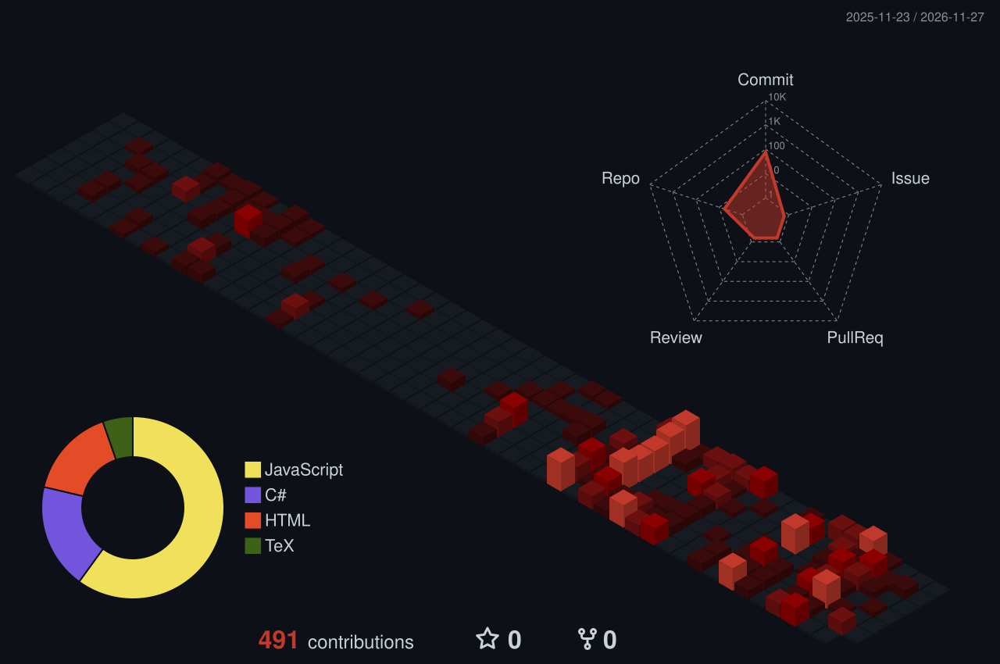
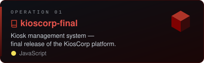
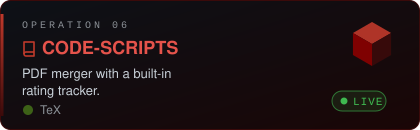
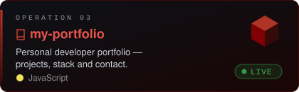
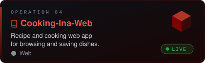

<!-- ╔══════════════════════════════════════════════════════════════════╗
     ║  ANIMUS PROFILE · AlbertJin1                                      ║
     ║  assets/animus-header.svg  → custom isometric 3D banner           ║
     ║  profile-3d-contrib/       → generated by .github/workflows       ║
     ╚══════════════════════════════════════════════════════════════════╝ -->

<div align="center">




<a href="https://jessie-albert-portfolio.vercel.app/"></a>
<a href="https://www.linkedin.com/in/jessie-albert-regualos-3a4765340/"></a>
<a href="https://github.com/AlbertJin1?tab=repositories"></a>


<sub><i>"Nothing is true, everything is permitted."</i></sub>

</div>


## ◈ SEQ·01 &nbsp;—&nbsp; Subject Profile

<table>
<tr>
<td width="55%" valign="top">

```yaml
subject:   Jessie Albert Regualos
alias:     AlbertJin1
class:     Full-Stack Developer
specialty:
  - React & React Native interfaces
  - Django / Node / PHP / C# backends
  - Database-backed systems & APIs
  - Desktop tooling in C#
platforms: [Supabase, Firebase, Vercel, zrok]
doctrine:  "Ship clean. Leave no trace of bugs."
status:    open_to_collaboration
```

</td>
<td width="45%" valign="top">

**🗡️ The Creed**

A technician of circuits and steel — I move between **frontend**, **backend**, and **infrastructure** like a hidden blade: swift, precise, unseen. I build the full system, from the interface a user touches to the database row behind it.

**🎯 Active Objectives**

- Full-stack web applications
- REST APIs & data-heavy systems
- Kiosk / POS / dashboard platforms
- Deploying & exposing apps securely

</td>
</tr>
</table>


## ◈ SEQ·02 &nbsp;—&nbsp; The Arsenal

<div align="center">

<table>
  <tr>
    <td align="center" width="50%">
      <br/>
      <b>◆ INTERFACE</b><br/>
      <sub>React · React Native · JavaScript · HTML · CSS</sub>
      <br/><br/>
      
      
      
      
      <br/><br/>
    </td>
    <td align="center" width="50%">
      <br/>
      <b>◆ CORE LOGIC</b><br/>
      <sub>Django · Python · Node.js · PHP · C# / .NET</sub>
      <br/><br/>
      
      
      
      
      
      
      <br/><br/>
    </td>
  </tr>
  <tr>
    <td align="center" width="50%">
      <br/>
      <b>◆ DATA</b><br/>
      <sub>PostgreSQL · SQL Server · Supabase · Firebase</sub>
      <br/><br/>
      
      
      
      
      <br/><br/>
    </td>
    <td align="center" width="50%">
      <br/>
      <b>◆ DEPLOY &amp; WORKFLOW</b><br/>
      <sub>Vercel · zrok · Git · GitHub · Actions</sub>
      <br/><br/>
      
      
      
      
      
      <br/><br/>
    </td>
  </tr>
</table>

</div>


## ◈ SEQ·03 &nbsp;—&nbsp; Animus Terrain <sub><sup>3D</sup></sub>

<div align="center">



<sub>Every commit raises the ground. Regenerated daily by GitHub Actions.</sub>

</div>


## ◈ SEQ·04 &nbsp;—&nbsp; Telemetry

<div align="center">

<table>
<tr>
<td align="center" valign="middle" width="50%">

</td>
<td align="center" valign="middle" width="50%">

</td>
</tr>
<tr>
<td align="center" colspan="2">

</td>
</tr>
</table>

</div>


## ◈ SEQ·05 &nbsp;—&nbsp; Featured Operations

<div align="center">

<a href="https://github.com/AlbertJin1/kioscorp-final"></a>
<a href="https://github.com/AlbertJin1/CODE-SCRIPTS"></a>
<a href="https://github.com/AlbertJin1/my-portfolio"></a>
<a href="https://github.com/AlbertJin1/Cooking-Ina-Web"></a>

</div>

```diff
+ ACTIVE    kioscorp-final ········· kiosk management system, final release
+ ACTIVE    my-portfolio ··········· personal developer portfolio
+ ACTIVE    CODE-SCRIPTS ··········· PDF merger with rating tracker
! MAINTAIN  kioscorp-dashboard ····· admin dashboard + backend API
```


## ◈ SEQ·06 &nbsp;—&nbsp; The Codex

> Ordered by most recent activity · 🔗 = live deployment

| # | Project | Description | Stack | Status |
|:--:|:--|:--|:--:|:--:|
| 01 | [**CODE-SCRIPTS**](https://github.com/AlbertJin1/CODE-SCRIPTS) [🔗](https://pdfmerger-rating-tracker.vercel.app) | PDF merger with rating tracker | `TeX` |  |
| 02 | [**my-portfolio**](https://github.com/AlbertJin1/my-portfolio) [🔗](https://my-portfolio-three-wheat-97.vercel.app) | Personal developer portfolio | `JavaScript` |  |
| 03 | [**kioscorp-final**](https://github.com/AlbertJin1/kioscorp-final) | Kiosk management system — final release | `JavaScript` |  |
| 04 | [**bonbon**](https://github.com/AlbertJin1/bonbon) | Web application project | `JavaScript` |  |
| 05 | [**kioscorp-dashboard**](https://github.com/AlbertJin1/kioscorp-dashboard) | Admin dashboard for the KiosCorp platform | `JavaScript` |  |
| 06 | [**kioscorp_dashboard_backend**](https://github.com/AlbertJin1/kioscorp_dashboard_backend) | Backend API powering the KiosCorp dashboard | `HTML` |  |
| 07 | [**Cooking-Ina-Web**](https://github.com/AlbertJin1/Cooking-Ina-Web) [🔗](https://cooking-ina-web.vercel.app) | Recipe and cooking web app | `Web` |  |
| 08 | [**Activity-Scenario-Task-Management-System**](https://github.com/AlbertJin1/Activity-Scenario-Task-Management-System--PHP-CRUD-) | PHP CRUD task management system | `PHP` |  |

<details>
<summary><b>🗄️ &nbsp;Decrypt the archive — 17 more repositories</b></summary>
<br/>

| Series | Repositories |
|:--|:--|
| **KiosCorp lineage** | [kioscorp-kiosk-v3](https://github.com/AlbertJin1/kioscorp-kiosk-v3) · [kioscorp-kiosk-v2](https://github.com/AlbertJin1/kioscorp-kiosk-v2) · [kioscorp-kiosk](https://github.com/AlbertJin1/kioscorp-kiosk) · [kioscorp-pos](https://github.com/AlbertJin1/kioscorp-pos) |
| **Cooking series** | [Cooking-Ina](https://github.com/AlbertJin1/Cooking-Ina) · [AmbatuCooks](https://github.com/AlbertJin1/AmbatuCooks) · [resto_trattoria](https://github.com/AlbertJin1/resto_trattoria) <sub>(fork)</sub> |
| **Apps** | [smartfit](https://github.com/AlbertJin1/smartfit) · [languageapp2](https://github.com/AlbertJin1/languageapp2) · [note2](https://github.com/AlbertJin1/note2) · [VROOM1](https://github.com/AlbertJin1/VROOM1) · [dog](https://github.com/AlbertJin1/dog) |
| **Auth & APIs** | [RestAPI](https://github.com/AlbertJin1/RestAPI) · [AuthProject](https://github.com/AlbertJin1/AuthProject) · [ProjectLogin](https://github.com/AlbertJin1/ProjectLogin) |
| **PHP & Data** | [DB-TRANSACTIONS](https://github.com/AlbertJin1/DB-TRANSACTIONS) · [AlbertJin1.github.io](https://github.com/AlbertJin1/AlbertJin1.github.io) |

</details>


<div align="center">

### 🤝 &nbsp;Desynchronize & Connect

Open to collaboration, interesting projects, and good conversations about building software.

<a href="https://www.linkedin.com/in/jessie-albert-regualos-3a4765340/"></a>
<a href="https://jessie-albert-portfolio.vercel.app/"></a>

<sub><i>"Requiescat in pace."</i> &nbsp;·&nbsp; <code>// end of memory sequence</code></sub>


</div>
